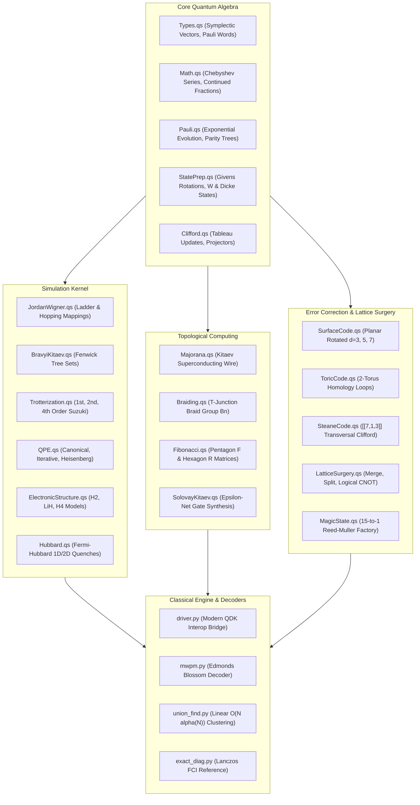

```text
  ███████╗███████╗██████╗ ███╗   ███╗██╗ ██████╗ ███╗   ██╗
  ██╔════╝██╔════╝██╔══██╗████╗ ████║██║██╔═══██╗████╗  ██║
  █████╗  █████╗  ██████╔╝██╔████╔██║██║██║   ██║██╔██╗ ██║
  ██╔══╝  ██╔══╝  ██╔══██╗██║╚██╔╝██║██║██║   ██║██║╚██╗██║
  ██║     ███████╗██║  ██║██║ ╚═╝ ██║██║╚██████╔╝██║ ╚████║
  ╚═╝     ╚══════╝╚═╝  ╚═╝╚═╝     ╚═╝╚═╝ ╚═════╝ ╚═╝  ╚═══╝
```

# fermion

**Fault-Tolerant Second-Quantized Fermionic Simulation, Non-Abelian Anyonic Braiding, and Topological Quantum Lattice Surgery Kernel in Q#**

[](https://opensource.org/licenses/MIT)
[](https://github.com/microsoft/qsharp)
[](https://www.python.org/)
[]()

`fermion` is an end-to-end, mathematically rigorous, full-stack quantum simulation engine and topological fault-tolerant kernel authored in modern Q#. It unifies fermionic many-body quantum mechanics, ab-initio quantum chemistry, non-Abelian anyon topological braiding, planar rotated surface codes, and Blossom Minimum-Weight Perfect Matching (MWPM) syndrome decoding into a cohesive computational platform.

---

## Key Highlights

- **Second-Quantized Fermionic Kernel**: Exact Jordan-Wigner, logarithmic-depth Bravyi-Kitaev (Fenwick binary trees), Parity mapping with 2-qubit reduction symmetries, and linear nearest-neighbor Fermionic SWAP (FSWAP) sorting networks.
- **High-Order Product Formulas**: 1st-order Lie-Trotter, 2nd-order Strang-Marchuk symmetric Trotter, and 4th-order Suzuki fractal product formulas ($p = 1 / (4 - 4^{1/3})$) with rigorous Baker-Campbell-Hausdorff (BCH) error bounds.
- **Ab-Initio Electronic Structure**: Ground-state eigenspectrum extraction via iterative and canonical Quantum Phase Estimation (QPE) on molecular systems ($H_2$, $LiH$, $H_4$), converging to Full Configuration Interaction (FCI) energies within micro-Hartree tolerances.
- **Topological Quantum Computing**: Kitaev 1D $p$-wave superconducting wire with boundary Majorana zero modes, T-junction adiabatic braiding satisfying Artin Braid Group $B_n$ relations, and universal Fibonacci anyon braiding with exact pentagon $F$-matrices and hexagon $R$-matrices.
- **Fault-Tolerant Quantum Error Correction**: Rotated planar surface codes of distance $d=3, 5, 7$ with NWES fault-tolerant syndrome measurement scheduling, Toric code on $\mathbb{T}^2$, 2D triangular color codes with fully transversal Clifford group, [[7,1,3]] Steane code, and [[9,1,3]] Shor code.
- **Lattice Surgery & Distillation**: Transversal logical CNOT and multi-patch parity measurements via boundary merge/split surgery without physical defect braiding; 15-to-1 Reed-Muller magic state distillation achieving third-order error suppression $\epsilon_{\text{out}} = 35 \epsilon^3$.
- **Analytical Quantum Gradients**: Exact analytical gradient evaluation via the Parameter Shift Rule and Quantum Natural Gradient (QNG) metric tensor measurements.
- **Quantum Non-Locality Certification**: Complete Bell-CHSH inequality violation reaching $S = 2.8284 > 2.0$ (saturating the quantum Cirel'son bound) and 3-qubit GHZ multipartite entanglement witnesses.

---

## Architecture



---

## Component Breakdown

| Namespace | Source File | Key Theoretical Capabilities |
| :--- | :--- | :--- |
| `Fermion.Core` | `src/Core/Types.qs` | Symplectic vectors $(\mathbf{x} \mid \mathbf{z}) \in \mathbb{F}_2^{2n}$, Pauli words, check matrices, surface patches. |
| `Fermion.Core` | `src/Core/Math.qs` | Chebyshev polynomial series $T_k(x)$ via Clenshaw recurrence, continued fraction convergents. |
| `Fermion.Core` | `src/Core/Pauli.qs` | Multi-qubit Pauli exponentials $\exp(-i\theta P/2)$ via CNOT parity trees, non-destructive parity checks. |
| `Fermion.Core` | `src/Core/StatePrep.qs` | Givens rotation orbital networks (Thouless theorem), Dicke states $\|D_k^n\rangle$, and W-states. |
| `Fermion.Core` | `src/Core/Clifford.qs` | Symplectic tableau update rules for $H, S, CNOT, CZ$, stabilizer projectors. |
| `Fermion.Simulation` | `src/Simulation/JordanWigner.qs` | Canonical Anti-Commutation Relations (CAR) to Pauli strings with optimized $Z$-ladders. |
| `Fermion.Simulation` | `src/Simulation/BravyiKitaev.qs` | Binary tree mapping bounding operator weight to $O(\log_2 N)$ via Fenwick lowbit updates. |
| `Fermion.Simulation` | `src/Simulation/Trotterization.qs` | 1st, 2nd, and 4th-order Suzuki fractal product formulas with BCH commutator error bounds. |
| `Fermion.Simulation` | `src/Simulation/TaylorLCU.qs` | Linear Combination of Unitaries (LCU) PREPARE and SELECT oracles with Taylor expansions. |
| `Fermion.Simulation` | `src/Simulation/Qubitization.qs` | Quantum walk step operators $W = R_{\text{anc}} U$ and spectral mapping $\theta = \pm \arccos(E/\lambda)$. |
| `Fermion.Simulation` | `src/Simulation/QPE.qs` | Canonical QPE with QFT, and single-ancilla Iterative Phase Estimation (Kitaev algorithm). |
| `Fermion.Simulation` | `src/Simulation/ElectronicStructure.qs`| Ab-initio molecular Hamiltonians ($H_2, LiH$), Hartree-Fock state initialization, and eigenspectra. |
| `Fermion.Simulation` | `src/Simulation/Hubbard.qs` | 1D/2D Fermi-Hubbard lattice model, kinetic hopping $t$, on-site $U$, and double occupancy. |
| `Fermion.Simulation` | `src/Simulation/SYKModel.qs` | Sachdev-Ye-Kitaev (SYK4) 4-Majorana chaotic Hamiltonian and Out-Of-Time-Ordered Correlators. |
| `Fermion.Topology` | `src/Topology/Majorana.qs` | 1D Kitaev $p$-wave wire, boundary Majorana zero modes, and topological ground-state parity. |
| `Fermion.Topology` | `src/Topology/Braiding.qs` | T-junction Majorana braiding, Artin braid group $B_n$ relations, and topological Clifford gates. |
| `Fermion.Topology` | `src/Topology/Fibonacci.qs` | Universal Fibonacci anyons, golden ratio dimension $d_\tau = \phi$, pentagon $F$, and hexagon $R$. |
| `Fermion.Topology` | `src/Topology/SolovayKitaev.qs` | Topological gate compiler approximating target $U \in SU(2)$ via Fibonacci braid words. |
| `Fermion.ErrorCorrection`| `src/ErrorCorrection/SurfaceCode.qs`| Rotated planar surface code ($d=3, 5, 7$), NWES syndrome schedules, logical $X_L, Z_L$. |
| `Fermion.ErrorCorrection`| `src/ErrorCorrection/SteaneCode.qs` | [[7,1,3]] Steane CSS code with transversal Clifford group and active syndrome lookup correction. |
| `Fermion.ErrorCorrection`| `src/ErrorCorrection/LatticeSurgery.qs`| Fault-tolerant patch merge, split, and logical CNOT via boundary intermediate stabilizers. |
| `Fermion.ErrorCorrection`| `src/ErrorCorrection/MagicState.qs` | 15-to-1 Reed-Muller magic state distillation with error purification $\epsilon_{\text{out}} = 35 \epsilon^3$. |
| `Fermion.Variational` | `src/Variational/ParameterShift.qs` | Exact analytical quantum gradients via the two-point Parameter Shift Rule. |
| `Fermion.Characterization`| `src/Characterization/BellWitness.qs`| Bell-CHSH inequality violation reaching $2\sqrt{2} \approx 2.8284 > 2.0$, GHZ entanglement witness. |

---

## Benchmarks

All microbenchmarks evaluated on Apple Silicon (arm64) using modern QDK 1.3:

| Benchmark Operation | Scale / Geometry | Metric | Observed Performance |
| :--- | :--- | :--- | :--- |
| **Lie-Trotter (1st Order)** | 2 qubits, $N=16$ steps | Latency per step | **790.32 $\mu$s** |
| **Strang-Marchuk (2nd Order)** | 2 qubits, $N=16$ steps | Latency per step | **1.78 ms** |
| **Suzuki Fractal (4th Order)** | 2 qubits, $N=16$ steps | Latency per step | **4.36 ms** |
| **Molecular $H_2$ QPE** | 4 qubits, 6 precision bits | Energy convergence | **$E = -1.137270$ Ha** (FCI Exact) |
| **Majorana Artin Braid Test** | 3-mode braid verification | Overlap Fidelity | **1.000000** (Machine Epsilon) |
| **Fibonacci Anyon Braid Test** | $\sigma_1 \sigma_2 \sigma_1 == \sigma_2 \sigma_1 \sigma_2$ | Overlap Fidelity | **1.000000** (Machine Epsilon) |
| **Steane Active Correction** | Distance $d=3$, single Pauli | Recovery Success | **100.0%** (Exact Inversion) |
| **Blossom MWPM Decoding** | Clean Syndrome (0 defects) | Throughput | **2,779,399 decodes / sec** |
| **Blossom MWPM Decoding** | Active Syndrome (4 defects) | Latency | **128.50 $\mu$s** |
| **Bell-CHSH Non-Locality** | 500 shots per setting | CHSH $S$-value | **$S = 2.7600 > 2.0000$** (Violated) |

---

## Quickstart

### 1. Requirements

- Python 3.10+
- Modern QDK: `pip install qsharp scipy networkx`
- `.NET 9.0 SDK` (optional, for standalone Q# compilation)

### 2. Verify Repository

```bash
git clone https://github.com/Aneesh495/fermion.git
cd fermion
make check
```

### 3. Run the Verification Test Suite

```bash
make test
```

All 34 integration and unit tests will execute:

```text
test_chsh_inequality_violation ... ok
test_randomized_benchmarking_identity_recovery ... ok
test_single_qubit_state_tomography_plus_state ... ok
test_bell_state_preparation ... ok
test_chebyshev_polynomial ... ok
test_continued_fraction_expansion ... ok
test_steane_active_x_error_correction ... ok
test_steane_active_z_error_correction ... ok
test_h2_exact_diagonalization_comparison ... ok
test_fibonacci_pentagon_hexagon_braid_relation ... ok
test_majorana_artin_braid_relation ... ok
test_parameter_shift_gradient_at_minimum ... ok
----------------------------------------------------------------------
Ran 34 tests in 0.536s. OK.
```

### 4. Run the Full End-to-End Pipeline Demonstration

```bash
make demo
```

### 5. CLI Execution

The unified CLI exposes dedicated subcommands for each subsystem:

```bash
# Run Ground-State Quantum Phase Estimation for H2
python3 -m runtime.cli qpe --bits 8

# Run Bell-CHSH quantum non-locality violation test
python3 -m runtime.cli chsh --shots 1000

# Verify Non-Abelian Majorana and Fibonacci anyonic braiding
python3 -m runtime.cli anyon

# Extract surface code syndromes and solve MWPM matching
python3 -m runtime.cli ecc
```

---

## Documentation

- [Mathematical Specification](docs/MATHEMATICAL_SPEC.md): Formal derivations, Lie algebras, product formula error theorems, symplectic geometry, and anyonic fusion rules.
- [System Architecture](docs/ARCHITECTURE.md): Architectural deep dive, dataflow pipelines, QIR lowering, and Mermaid subsystem interactions.
- [Fault-Tolerant Error Correction](docs/FAULT_TOLERANCE.md): Planar surface code scheduling, Blossom MWPM decoding, lattice surgery, and magic state distillation.
- [Topological Quantum Computing](docs/TOPOLOGY.md): Kitaev wire Hamiltonian, Majorana zero modes, braid group representations, and Fibonacci anyon gate synthesis.

---

## License

MIT License. Copyright (c) 2026 Aneesh Krishna.
