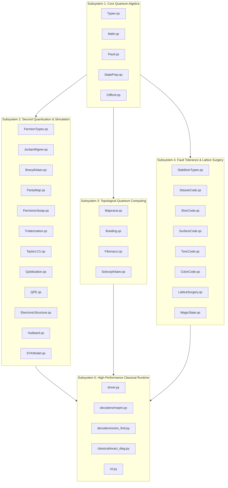
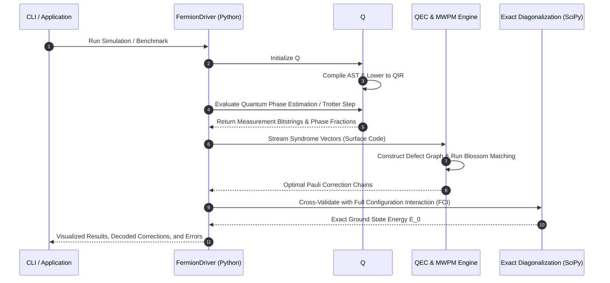

# System Architecture

The `fermion` kernel is organized as a high-performance, modular full-stack quantum simulation and fault-tolerant computing framework. Q# serves as the primary execution heart, while Python provides high-performance classical decoders, orchestration drivers, and analytical verification tooling.

---

## 1. High-Level Subsystem Organization

---

## 2. Component Directory Structure

- `src/Core/`: Symplectic Pauli algebra, Clifford group tableaus, arbitrary state preparation (Givens, W-states, Dicke states), and arbitrary-precision quantum math (Chebyshev polynomial series, continued fractions).
- `src/Simulation/`: Second quantization CAR algebra, Jordan-Wigner, Bravyi-Kitaev, Parity mapping, Fermionic SWAP networks, Trotter-Suzuki product formulas (1st, 2nd, 4th order), Taylor LCU, Qubitization, and ab-initio molecular models ($H_2, LiH, H_4$).
- `src/Topology/`: Kitaev 1D $p$-wave wire, T-junction Majorana zero mode braiding, Artin braid group $B_n$ relations, Fibonacci anyon model, and Solovay-Kitaev topological compiler.
- `src/ErrorCorrection/`: CSS check matrix calculus, [[7,1,3]] Steane code, [[9,1,3]] Shor code, rotated planar surface codes ($d=3, 5, 7$), Toric code on $\mathbb{T}^2$, 2D color codes, lattice surgery merge/split protocols, and magic state distillation.
- `src/Variational/`: Hardware-efficient ansatze, UCCSD, and exact analytical Parameter Shift Rule gradient evaluation.
- `src/Characterization/`: Full Quantum State Tomography (Stokes reconstruction), Randomized Benchmarking (standard and interleaved), and Bell-CHSH quantum non-locality violation.
- `runtime/`: Unified Python driver interfacing directly with the modern QDK Rust runtime (`qdk.qsharp`), Blossom algorithm MWPM decoder, and terminal visualizers.

---

## 3. End-to-End Execution Dataflow

---

## 4. QIR Compilation and Hardware Lowering

Modern Q# compiles directly into Quantum Intermediate Representation (QIR), an LLVM 14+ compatible intermediate representation specification.

The compilation pipeline operates as follows:
1. `src/*.qs` source files are parsed and type-checked by the Q# compiler frontend.
2. Abstract Syntax Tree (AST) representations are lowered into SSA (Static Single Assignment) form.
3. Quantum operations map to QIR intrinsic function calls: `__quantum__qis__rz__body`, `__quantum__qis__cnot__body`, `__quantum__rt__qubit_allocate`.
4. High-level fermionic structures and stabilizer operations compile to standardized bitcode ready for execution on physical hardware QPUs or local simulators.
